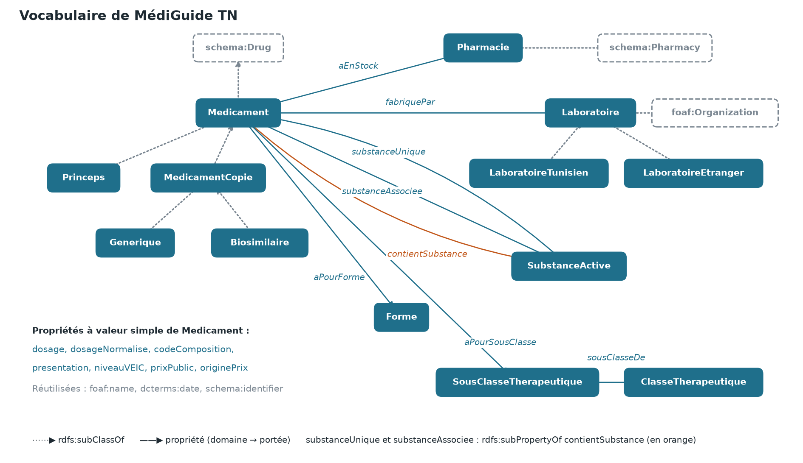

# MédiGuide TN

Un guide des médicaments et de leurs équivalents en Tunisie : graphe RDF, vocabulaire RDFS, règles d'inférence, requêtes SPARQL et web service REST en JSON.

## Le problème

Beaucoup de médicaments contiennent la même substance active sous des noms et des prix différents. Les patients ne savent pas qu'il existe un équivalent moins cher, ni lesquels sont fabriqués en Tunisie. MédiGuide TN relie chaque médicament à sa substance active, son laboratoire et son prix, et montre ses équivalents.

## Le schéma



## Comment lancer

Sous Windows, à la racine du projet :

```
python -m venv .venv
.venv\Scripts\python -m pip install -r requirements.txt
.venv\Scripts\python -m uvicorn app.main:app
```

Attendre environ 15 secondes, puis ouvrir http://127.0.0.1:8000/docs.

Pour tout régénérer depuis les CSV :

```
.venv\Scripts\python scripts\auditer_donnees.py
.venv\Scripts\python scripts\classer_laboratoires.py
.venv\Scripts\python scripts\completer_donnees.py
.venv\Scripts\python scripts\csv_vers_rdf.py
.venv\Scripts\python scripts\verifier_vocabulaire.py
.venv\Scripts\python scripts\dessiner_schema.py
.venv\Scripts\python scripts\comparer_inference.py
```

## Exemples d'appels

| Appel | Question |
|---|---|
| `/statistiques/inference?inference=false` | Ce que l'inférence ajoute |
| `/substances/top?limite=5` | Les substances qui ont le plus de médicaments |
| `/medicaments?substance=paracetamol&origine=tunisien&type=copie` | Les copies tunisiennes au paracétamol, du moins cher au plus cher |
| `/medicaments/9103482/equivalents?en_stock=true` | Les équivalents de Doliprane 500 mg en stock |
| `/sous-classes/dependance-etranger` | Les sous-classes sans aucun laboratoire tunisien |
| `/substances/source-unique` | Les substances d'un médicament vital qui dépendent d'un seul laboratoire |

## Résultats

- 6 059 lignes CSV, 6 047 médicaments, 1 044 substances, 432 laboratoires.
- 96 078 triplets sans inférence, 120 371 avec : 24 293 triplets déduits par R1 et R2 (`resultats/comparaison_inference.md`).
- Médicaments de type `med:Medicament` : 0 sans inférence, 6 047 avec.
- 8 sous-classes sans laboratoire tunisien, 71 substances à source unique.

## Limites

- **Prix :** 289 médicaments ont un prix réel de la liste PCT de juillet 2026 (4,8 %). Les 5 758 autres ont un prix estimé par `scripts/completer_donnees.py`, à partir du prix réel le plus proche et de valeurs de repère. Chaque prix est marqué `reel` ou `estime`.
- **Économies :** les règles d'estimation rendent les génériques moins chers, et aucun prix réel ne concerne un laboratoire tunisien. Les économies sur les génériques tunisiens sont donc des illustrations, pas des chiffres de marché.
- **Prix PCT à vérifier :** 52 lignes valent exactement 5 ou 10 DT. Elles sont conservées, mais ne servent pas de référence aux estimations.
- **Laboratoires :** leur origine a été classée par une IA, sans source officielle ; 17 sont marqués `a_verifier` (634 lignes du CSV). Ce classement influence Q2, Q3 et Q5. La colonne `Laboratoire` indique le titulaire de l'AMM, pas forcément le site de fabrication.
- **Stock :** la pharmacie est fictive.
- **Équivalents :** il faut la même composition, le même dosage et la même forme exacte (`Comprimé` ≠ `Comprimé sécable`) ; les 545 médicaments sans dosage n'ont pas d'équivalents. Ce guide ne remplace pas l'avis d'un médecin ou d'un pharmacien.

## Usage de l'IA

Le code, les requêtes, le classement des laboratoires, les prix estimés, le stock fictif et les diapositives ont été produits avec l'aide d'une IA générative (Claude Code).
