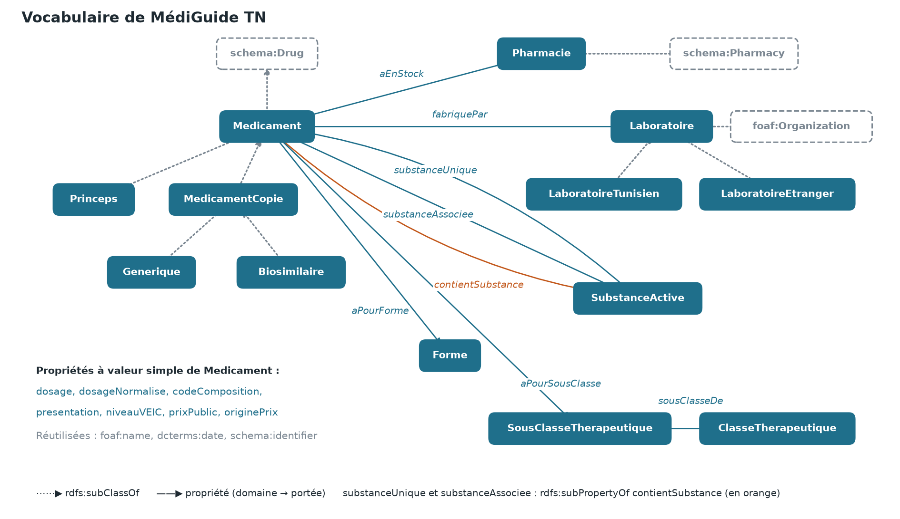

# Texte de MediGuide-TN-v3.pptx

Pied de page des diapos de contenu : MédiGuide TN · Web Sémantique · Malek Rezgui

## Page de titre

**MédiGuide TN** : graphe de connaissances des médicaments et génériques en Tunisie.

Malek Rezgui · Web Sémantique · Mme Ahlem Tayachi · 4 novembre 2026

---

## Le projet : de la liste des AMM à Swagger

Collecte (liste des AMM, prix PCT de juillet 2026) → Conversion (CSV vers Turtle, prix complétés et marqués) → Graphe RDF (medicaments.ttl + vocabulaire.ttl) → Inférence (règles R1 et R2) → Requêtes (6 requêtes SPARQL) → Service (API REST + Swagger)

**Pour qui ?**
- **Pharmacien :** je n'ai plus de Doliprane : quels équivalents ai-je en stock, du moins cher au plus cher ?
- **Patient :** mon traitement coûte trop cher : existe-t-il un générique moins cher ?
- **Analyste du ministère :** quels types de médicaments dépendent uniquement de laboratoires étrangers ?

---

## 1. MédiGuide TN : trouver l'équivalent moins cher

**Le constat :** beaucoup de médicaments contiennent la même substance active sous des noms et des prix différents. Les patients ne savent pas qu'il existe un équivalent moins cher, ni lesquels sont fabriqués en Tunisie.

**Notre réponse :** un guide qui relie chaque médicament à sa substance active, son laboratoire et son prix, et qui montre ses équivalents.

- Le pharmacien remplace un médicament absent
- Le patient trouve un générique moins cher
- L'analyste repère la dépendance à l'étranger

**6 047** médicaments, **1 044** substances, **432** laboratoires.

**D'où viennent les données**
- Liste des AMM : 6 059 lignes réelles.
- Prix réels (PCT, juillet 2026) : 289 médicaments, soit 4,8 %.
- Prix estimés : 5 758 médicaments, à partir du prix réel le plus proche. Chaque prix est marqué reel ou estime.
- Générés par IA : l'origine des laboratoires (35 tunisiens, 397 étrangers, 17 à vérifier) et le stock d'une pharmacie fictive.

*Code et données complétées produits avec l'aide d'une IA générative.*

---

## 2. Le vocabulaire : 13 classes, 18 propriétés

- **Classes :** Générique ⊂ MedicamentCopie ⊂ Medicament ⊂ schema:Drug
- **Propriétés :** substanceUnique et substanceAssociee ⊂ contientSubstance
- **Domaine, portée :** fabriquePar, de Medicament vers Laboratoire
- **Réutilisés :** schema.org, FOAF, Dublin Core

---

## 3. Inférence RDFS : 24 293 triplets déduits

| Règles | Définition (cours) | Écrit pour Doliprane 500 mg | Déduit |
|---|---|---|---|
| R1, sous-classes (17 143 triplets) | Si x de type C ET C ⊂ C' ALORS x de type C' | a med:Princeps ; Princeps ⊂ Medicament ⊂ schema:Drug | a med:Medicament, a schema:Drug |
| R2, sous-propriétés (7 150 triplets) | Si p(x,y) ET p ⊂ p' ALORS p'(x,y) | substanceUnique paracétamol ; substanceUnique ⊂ contientSubstance | contientSubstance paracétamol |

| Même question | Sans | Avec | Règle |
|---|---|---|---|
| Triplets du graphe | 96 078 | 120 371 | R1 + R2 |
| Nombre de médicaments | 0 | 6 047 | R1 |
| Copies (génériques et biosimilaires) | 0 | 4 184 | R1 |
| Équivalents de Doliprane 500 mg | 0 | 13 | R1 |
| Médicaments au paracétamol | 0 | 169 | R2 |

**Ce que ça change**
- Dans les données, on écrit seulement le type et la propriété les plus précis.
- Sans inférence, une recherche sur le paracétamol ne donne rien : le terme général n'est jamais écrit.
- Avec R2, elle réunit les 87 médicaments au paracétamol seul et les 82 en association.
- Les triplets déduits sont dans resultats/triplets_inferes.ttl.

---

## 4. Les 6 requêtes SPARQL

| Requête | Notion | À quoi elle sert | Exemple de réponse |
|---|---|---|---|
| Q0 · Nombre de médicaments | COUNT | Montrer l'apport de l'inférence | 0 sans, 6 047 avec |
| Q1 · Substances les plus présentes | GROUP BY, ORDER BY | Voir où le choix est le plus large | Paracétamol : 169 médicaments, 27 laboratoires |
| Q2 · Recherche filtrée | 4 filtres, initBindings | Chercher par substance, forme, origine, type | Paracétamol : 169, du moins cher au plus cher |
| Q3 · Dépendance à l'étranger | FILTER NOT EXISTS | Repérer les types sans laboratoire tunisien | 8 sous-classes, dont les antihémorragiques (69) |
| Q4 · Source unique | HAVING, GROUP_CONCAT | Repérer le risque de rupture | 71 substances liées à un médicament vital, un seul laboratoire |
| Q5 · Équivalents | jointure, OPTIONAL | Remplacer un médicament, économiser | Doliprane 500 mg comprimé : 13 équivalents, 1 en stock |

---

## 5. Web service REST (FastAPI)

| Endpoint (GET) | Qui s'en sert, pour quoi |
|---|---|
| /medicaments | Patient, pharmacien : chercher par substance, forme, origine, type |
| /medicaments/{amm}/equivalents | Pharmacien : remplacer un produit, voir le stock et l'économie |
| /substances/top | Voir où le choix est le plus large |
| /substances/source-unique | Ministère : risque de rupture |
| /sous-classes/dependance-etranger | Ministère : dépendance à l'étranger |
| /statistiques/inference | Voir ce que l'inférence ajoute |

- Paramètre inference=true|false sur tous les endpoints
- Erreurs : 404 si l'identifiant est inconnu, 422 si un paramètre est invalide
- Paramètres liés par initBindings, pas d'injection SPARQL

**Exemple :** Micardis 40 mg, 56,838 DT. `GET /medicaments/1153031/equivalents` renvoie Telmisartan Mylan B/30, 16,255 DT, `originePrix: reel`, `economiePct: 73` : 73 % moins cher par comprimé, les deux prix sont réels.

**Limite :** aucun prix réel ne concerne un laboratoire tunisien. Pour eux, l'économie affichée est une illustration.
